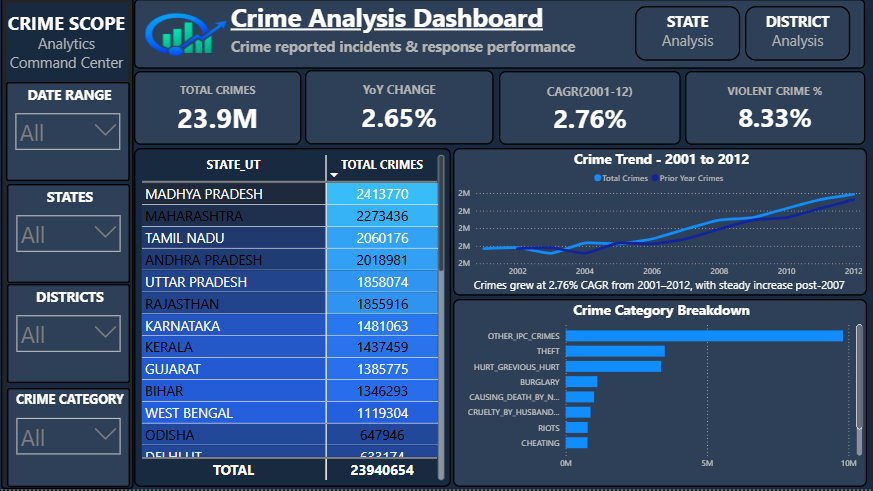
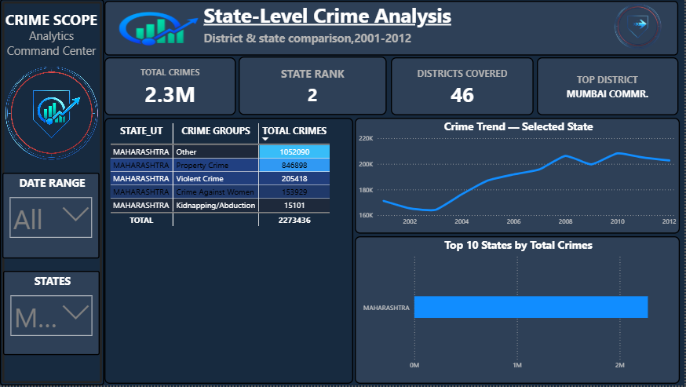
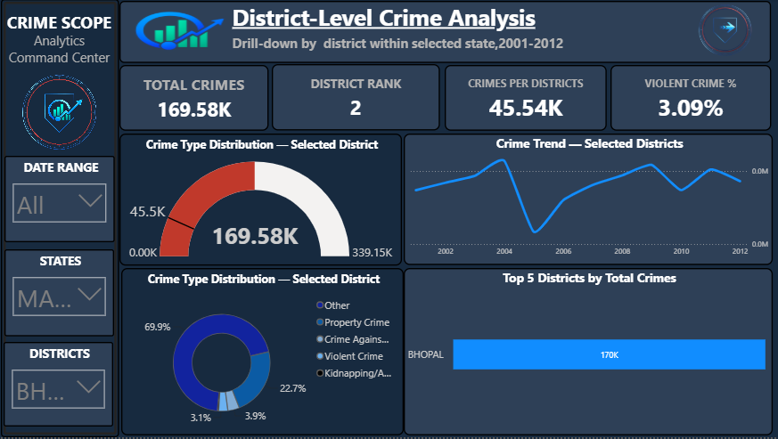

<!-- <p align="center">
  
</p> -->

<h1 align="center">CrimeScope — India Crime Analytics</h1>

<p align="center">
  End-to-end analytics project: <b>MySQL → pandas → Power Query → DAX → Power BI</b><br>
  12 years · 35 States/UTs · 806 Districts · 23.9M recorded IPC crimes
</p>

---

## Overview

CrimeScope analyses district-wise IPC crime data published by India's National Crime Records Bureau (NCRB) for **2001–2012**. The project follows the full workflow of a working analyst: load raw data from a database, validate it independently, reshape it, model it as a star schema, write DAX measures, and present the result in a 3-page interactive Power BI dashboard (national → state → district drill-down).

---

---


---


---


## Key finding

Summing the 29 crime-category columns gives **28,037,178** cases, but the dataset's own `TOTAL_IPC_CRIMES` column adds up to **23,940,654**. Using pandas, the 4.1M gap was traced to six sub-category columns that are already counted inside a parent category:

| Sub-category | Already included in |
|---|---|
| `CUSTODIAL_RAPE`, `OTHER_RAPE` | `RAPE` |
| `KIDNAPPING_AND_ABDUCTION_OF_WOMEN_AND_GIRLS`, `KIDNAPPING_AND_ABDUCTION_OF_OTHERS` | `KIDNAPPING_AND_ABDUCTION` |
| `AUTO_THEFT`, `OTHER_THEFT` | `THEFT` |

Excluding them reconciles the total to **exactly 23,940,654**. Without this check every KPI downstream would have been overstated by about 17%.

## Headline numbers

| Metric | Value |
|---|---|
| Total recorded crimes (2001–2012) | 23,940,654 |
| CAGR 2001–2012 | 2.76% |
| YoY change 2011 → 2012 | 2.65% |
| Violent crime share | 8.33% |
| Highest-volume state | Madhya Pradesh (2,413,770), then Maharashtra (2,273,436) |

Every DAX measure was checked against the pandas figures above before being used in the dashboard.

## Tech stack

| Layer | Tool |
|---|---|
| Storage | MySQL |
| Validation | Python 3, pandas |
| ETL | Power Query (M) |
| Modeling | Power BI star schema |
| Calculations | DAX |
| Visualization | Power BI Desktop |

## Data model

Star schema with one fact table and two dimensions:

- **Fact_Crimes** — one row per State × District × Year × CrimeCategory (`Cases`, plus a derived `CrimeGroups` column: Violent Crime, Property Crime, Crime Against Women, Kidnapping/Abduction, Other)
- **Dim_Year** — 2001–2012
- **Dim_State** — 35 states/UTs

Relationships: `Dim_Year[Year] → Fact_Crimes[YEAR]` and `Dim_State[STATE_UT] → Fact_Crimes[STATE_UT]` (one-to-many, single direction).

## Dashboard pages

1. **Crime Analysis** — national KPIs, trend line, category breakdown, state-wise heat table
2. **State Analysis** — state rank, Top 10 states and districts, State × CrimeGroup matrix
3. **District Analysis** — district rank within state, district vs state-average gauge, crime-type donut, top-district funnel

## Repository structure

```
crimescope/
├── data/                 crime_cleaned_2001_2012.csv
├── python/               validate_data.py  (pandas profiling + reconciliation)
├── powerquery/           Fact_Crimes.m     (unpivot, clean, categorize)
├── dax/                  measures.dax      (all report measures)
├── powerbi/              CrimeScope.pbix   (add your report file here)
└── docs/                 project report (PDF), logo, screenshots
```

## How to reproduce

**1. Validate the data (no Power BI needed)**

```bash
pip install pandas
python python/validate_data.py data/crime_cleaned_2001_2012.csv
```

Expected output includes `Reconciled: True` and the KPI values listed above.

**2. Load into MySQL**

Create a schema named `crime_analysis` and import `data/crime_cleaned_2001_2012.csv` into a table called `crime_data` (for example with the MySQL Workbench *Table Data Import Wizard*).

**3. Build the model in Power BI Desktop**

1. *Get Data → MySQL database* and point it at `crime_analysis.crime_data`.
2. Paste the query from `powerquery/Fact_Crimes.m` into the Advanced Editor and name it `Fact_Crimes`.
3. Create `Dim_Year` and `Dim_State` and relate them to `Fact_Crimes` as described above.
4. Add the measures from `dax/measures.dax`.

If you don't want to use MySQL, replace the `Source` step in the query with a Text/CSV source pointing at the CSV file; the remaining steps are identical.

## Lessons learned / debugging notes

| Problem | Cause | Fix |
|---|---|---|
| Total inflated to 28M | Parent and sub-category columns both summed | Excluded 6 overlapping columns |
| YoY showed 929.5% | Measure evaluated with no year in context (all-years total vs one prior year) | Latest-year / prior-year measures that set their own year filter |
| CAGR displayed 0 | 0.0276 shown in a non-percentage format | Format as percentage |
| Rank always 1 | Slicer on "All" → no single item in context | `HASONEVALUE` guard + count-based ranking |
| District rank 190,864 | `RANKX` ranked raw unpivoted rows, not districts | Rank over `VALUES(DISTRICT)` |
| Map visuals disabled | Tenant policy blocks Bing Maps visuals | Conditionally formatted matrix instead |

## Limitations

- The data ends in 2012; findings describe that period, not current crime levels.
- Figures are *reported* IPC crimes, which depend on reporting and registration practices and differ across states.
- The dataset has no population column, so per-capita rates are not calculated.

## Data source

India NCRB IPC crime statistics (district-wise), 2001–2012. The CSV in `data/` is a cleaned copy used for this project. Please check the original publisher's terms before redistributing.

